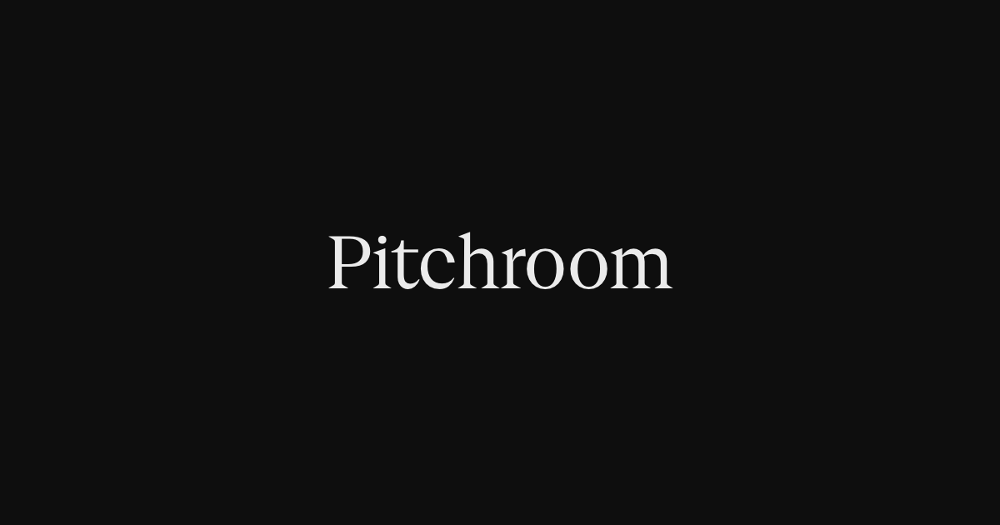

# Pitchroom

**Every decision here is mine. The code is written by Claude.** What Pitchroom does, how it looks, how it behaves and what's left out are my calls, checked by using it. The code is Claude's ([Claude Code](https://claude.com/claude-code)), working from the notes in [CLAUDE.md](CLAUDE.md). More under [How it's made](#how-its-made).

Singing practice on your own computer, for macOS and Windows: [pitchroom.dev](https://pitchroom.dev). Add a song from a YouTube link and Pitchroom splits it into its parts (vocals, drums, bass and the rest), finds its melody and lyrics, and lets you sing along: the singer's notes scroll past, your own pitch is drawn on top, and you can loop a phrase, change the key or tempo, and record takes. Songs, takes and models stay on your computer.

> **For personal practice only.** Use audio you have the right to use; downloading from YouTube may go against YouTube's Terms of Service. Songs, lyrics and models are never part of this repository.

## Get the app

An installer, a window of its own, no terminal. Download it from [pitchroom.dev](https://pitchroom.dev) or from [Releases](https://github.com/freaktion-craft/pitchroom-releases/releases/latest):

| OS | File |
|---|---|
| macOS (Apple silicon) | `Pitchroom-…-mac-arm64.dmg` |
| macOS (Intel) | `Pitchroom-…-mac-x64.dmg` |
| Windows | `pitchroom_install.exe` |

Python comes inside it, so there's nothing else to install. The first song needs the song tools, which split songs and read their melody and lyrics (3–4 GB, downloaded once).

- **Opening it the first time.** The app isn't signed yet, so the system asks once. On macOS: open it, then **System Settings → Privacy & Security → Open Anyway**. On Windows: at "Windows protected your PC", **More info → Run anyway**.
- **Your songs** are kept in the app's own folder, so updates never touch them: `~/Library/Application Support/Pitchroom` on macOS, `%APPDATA%\Pitchroom` on Windows (**Help → Open Data Folder**).
- **Updates.** It looks for a newer version as it opens and updates itself (also **Check for Updates…** in the menu).

## What's inside

**Library.** Paste YouTube links, or a YouTube or Spotify playlist to pick songs from. Each song is split into vocals, drums, bass and the rest, and the vocals into lead and backing; its beat, key, melody and lyrics are read as part of adding it. Songs are added one at a time, the rest waiting in line. Each is listed as what it is, not by its video's title: its title, artist and album art as found on iTunes or Deezer. Browse by **Song**, **Artist** or **Album**, sort by a column, or search (Ctrl K or ⌘K, or /). Another singer's **cover** of a song is kept inside that song, not as a row of its own: the singer's name in the song's title is a menu to switch between them and to add a cover from its YouTube link. A cover has its own band and tracks; you mark where its first line starts and its start is cut to match, and it takes the song's lyrics, lined up with its own voice.

**Studio**, a song's own page. Every track with mute, solo and volume, and a metronome that follows the song's own tempo. **Key** moves the song up to 6 semitones either way, and tempo plays it at 50–150 % at the same pitch; Practice, downloads and takes follow. Drag across a muted track and press **Keep playing here** to keep that stretch sounding. **Download** writes the mix you hear as an MP3. **Info** has the song's tempo, key and the melody's range, and looks its lyrics up again or takes them pasted in.

**Practice.** The melody is read from the lead vocal, so note bars scroll in while the band plays; the singer's own pitch line is drawn faintly behind them, yours on top. The lead vocal stays on as a guide with its own volume. Lyrics are lined up with the voice syllable by syllable and fill in as they're sung. The song is cut into phrases, a line of the lyrics each: jump to one and it counts you in, **Loop** (L) repeats it, a drag across the strip loops a run of them, ← and → move between them. If a line's timing is off, `,` and `.` move it earlier or later (`[` and `]` all of them), and **Edit** opens the timing to fix by hand, and a line's words too (double-click it), or adds and deletes lines, for a cover that sings it differently. **Headphones** sends the band, the guide and the metronome each to the ear you want.

**Takes.** **Record** (R) keeps a take each time the song plays, or the whole song as one, timed to the band. Play one back over the band, compare it with the original (one in each ear), or download it as a WAV. **Takes Studio** lays takes out on the song's timeline to play together, each at its own volume; **Sync** moves them earlier or later, and **Match** puts them where the singer comes in. If your voice comes through a DAW or a loopback, **Settings → Recording** measures its delay so takes allow for it.

**Lab.** Exercises for the voice alone, at the piano, with a Spectrogram and an EQ of what the mic hears. **Scales** plays a pattern and you sing it back; **Reach** tries ways onto one note and reads how you arrive, settle and hold; **Match** plays one note to sing back and brings the ones you miss around again; **Piano** is the keyboard alone, played from the computer's keys. Its judging is new and not yet tried with many voices.

**Live** (Windows). The song and your voice as one microphone other apps can use, for a call or a stream, through [VB-CABLE](https://vb-audio.com/Cable/).

**Settings.** English or Korean (한국어), light or dark, an accent colour, note names, and which mic and output to use.

Use earphones while practising so the song doesn't leak into the mic, or turn on **Filter out speaker sound** in Settings.

## Run it from source

For working on it, or without an installer. No GitHub account needed: **Code → Download ZIP** on this page and unzip it anywhere, or

```bash
git clone https://github.com/freaktion-craft/pitch-room.git
```

**Start it.** Double-click the launcher for your system:

| OS | File |
|---|---|
| Windows | `start-windows.bat` |
| macOS | `start-mac.command` |

The first run makes a Python environment in `.venv` and installs the base packages. After that it starts in a couple of seconds and opens a tab in Chrome (or your default browser). Close the terminal window to stop it.

- **Needs:** nothing installed beforehand. The launcher uses the computer's Python if it has 3.9 or newer (3.10 or newer to split lead from backing vocals); if not, it fetches its own Python 3.11 through [uv](https://github.com/astral-sh/uv) into `.tools`, and nothing outside the folder changes.
- **macOS:** if double-clicking says the file can't be opened, right-click it → **Open** once. If it says permission denied, run `chmod +x start-mac.command` in Terminal.
- **Song tools:** the first run offers them, and **Settings → Advanced → Song tools** installs them later (PyTorch, Demucs, Whisper and the rest, 3–4 GB). The first song with Korean or English lyrics adds a model that times their syllables (1.3 GB for Korean, 0.4 GB for English).
- **GPU:** on Windows the install looks for an NVIDIA card and takes the CUDA build of PyTorch your driver supports (CUDA 12.4 or newer). AMD and Intel graphics run on the CPU. Macs use the Apple GPU.
- **Songs** are kept in `library/`. The app doesn't share them: to bring them over, **Settings → Advanced → Import beta library** in the app and pick this folder (it's copied, not moved).

**Update it.** Close Pitchroom, then double-click the updater for your system in `update/`: `update-windows.bat` or `update-mac.command`. A git clone is pulled; a downloaded copy gets the latest version's files. Your songs, takes, settings and models stay as they are. When a new version times lyrics better, **Update** in the library times your songs again.

**The server alone:** `.venv/bin/python server.py` on macOS, `.venv\Scripts\python.exe server.py` on Windows (port 5178).

**The desktop app** is built in `desktop/` (Node 22.12 or newer): `npm ci`, then `npm run python` (fetches the app's own Python into `desktop/runtime`), then `npm start` to run it or `npm run dist` for an installer in `desktop/dist`. Releases are built on my own computers, Windows on a PC and macOS on a Mac, into [pitchroom-releases](https://github.com/freaktion-craft/pitchroom-releases), which holds the installers only. Steps: [docs/agents/desktop-and-release.md](docs/agents/desktop-and-release.md).

## How it's made

I don't write the code. I decide what goes in, how it looks and how it behaves, try each change, and say what's wrong; Claude writes it and checks it.

- [CLAUDE.md](CLAUDE.md) and [docs/agents/](docs/agents/) are what the agents read first: my rules, the problems already solved (so they don't come back), and what to reuse.
- Commit subjects say what is now true and why, so `git log` reads as the record of the decisions.
- It's plain HTML, CSS and JavaScript with a Python server: no framework, no bundler, no test suite.

## Files

| | |
|---|---|
| `index.html` | The page's markup, and the order its scripts load in |
| `css/` | `tokens.css` (the design tokens, both themes), then `base`, `stage`, `stems`, `practice` |
| `js/` | The page's 24 plain scripts, sharing one scope: `core` first, `app` last. The Lab's judging (`turn`, `scale`, `reach`, `match`) also runs in Node |
| `server.py` | Serves the page and the API, on this computer only |
| `stems.py` | The library and settings, adding a song (download, splitting, beat and key, lyrics), key and tempo versions, downloads, takes |
| `melody.py` | The singer's notes and pitch line, from the lead vocal |
| `syllables.py` | The lyrics' syllables timed on the lead vocal |
| `lyrics.py`, `covers.py`, `playlists.py` | Lyrics from LRCLIB; song names and covers from iTunes and Deezer; YouTube and Spotify playlists |
| `launch.py`, `start-*` | The launchers: install the base packages, find a free port, start the server, open the browser |
| `update.py`, `update/` | Brings a copy run from source up to date |
| `desktop/` | The Electron app around the same page and server |
| `site/` | The download page at pitchroom.dev |
| `scripts/` | Checks: the colours' contrast, and the Lab's judging on made-up voices |
| `CLAUDE.md`, `docs/agents/` | The notes the coding agents work from |

## Credits

- Piano (the keyboard in Practice and the Lab): [Salamander Grand Piano](https://archive.org/details/SalamanderGrandPianoV3) by Alexander Holm (CC-BY 3.0), loaded at runtime from the Tone.js sample host.
- Font: [Pretendard](https://github.com/orioncactus/pretendard) (SIL OFL 1.1), loaded from jsDelivr.
- Icons: [Hugeicons](https://hugeicons.com) (MIT).
- Splitting: [Demucs](https://github.com/facebookresearch/demucs) (htdemucs) on PyTorch; lead and backing vocals with [audio-separator](https://github.com/nomadkaraoke/python-audio-separator) and the BS-Roformer karaoke model by frazer & becruily.
- Melody: RMVPE (Wei et al., the RVC project's weights, MIT), with [librosa](https://librosa.org)'s pYIN and [Praat](https://www.fon.hum.uva.nl/praat/) (through parselmouth) to fall back on. Beats and key with librosa.
- Key and tempo: Rubber Band, through ffmpeg (imageio-ffmpeg).
- Downloads: [yt-dlp](https://github.com/yt-dlp/yt-dlp), with [Deno](https://deno.com) as its JavaScript runtime.
- Album art: the [iTunes Search API](https://performance-partners.apple.com/search-api) and the [Deezer API](https://developers.deezer.com/api), or YouTube's thumbnail.
- Lyrics: [LRCLIB](https://lrclib.net), lined up with the voice by OpenAI's [Whisper](https://github.com/openai/whisper) (turbo) through [stable-ts](https://github.com/jianfch/stable-ts), their syllables by [wav2vec2-large-xlsr-korean](https://huggingface.co/kresnik/wav2vec2-large-xlsr-korean) and [wav2vec2-base-960h](https://huggingface.co/facebook/wav2vec2-base-960h).
- Live: [VB-CABLE](https://vb-audio.com/Cable/) by VB-Audio.

## License

[MIT](LICENSE), for Pitchroom's own code. The name "Pitchroom" and its mark (the P) aren't part of it: a changed copy goes by a name of its own. The libraries and models it uses keep their own licences (above; Praat through parselmouth is GPL-3.0: the start scripts install it from PyPI, and the desktop app leaves it out). The songs and recordings you add, and what's made from them, are yours.
